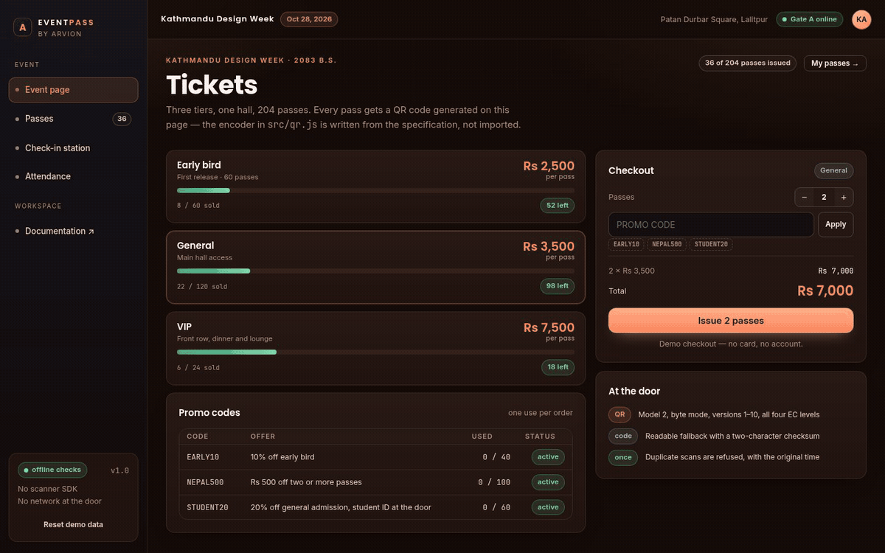
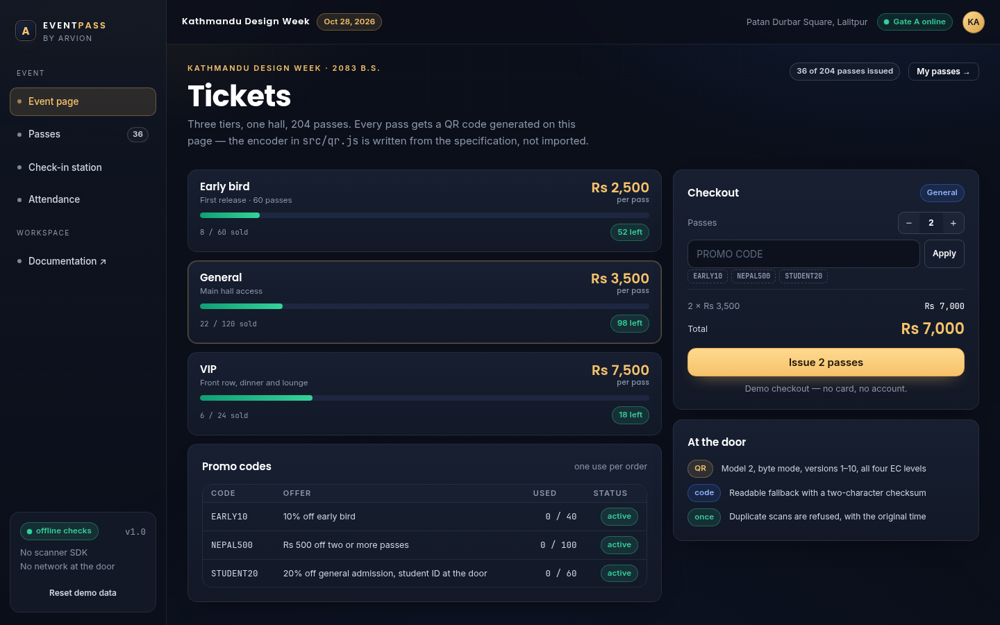

<div align="center">

</div>

<sub>Recorded from the live demo — <a href="docs/demo.mp4">MP4</a> · <a href="docs/screenshot.png">static frame</a></sub>

# EventPass

A ticketing page, a QR pass and a door station. Tiers, promo codes, attendance
stats — and a QR Code Model 2 encoder written from the specification, so the
demo ships no scanner SDK, no font and no network call at the gate.

[**Open the live demo**](https://arvion-technology.github.io/labs/demos/eventpass/demo/) · [CI](https://github.com/arvion-technology/eventpass/actions/workflows/ci.yml) · [MIT](LICENSE)

---

Every ticketing demo imports a QR library. That felt like the wrong shortcut for
a repository whose point is showing how we build: the interesting part is the
encoding, not the `import`. So `src/qr.js` implements Galois-field arithmetic,
Reed-Solomon error correction, block interleaving, the function patterns, the
zig-zag data placement, all eight masks and the four penalty rules. The demo is
the proof it works — each pass on the page is a real, scannable QR symbol.

The rest is deliberately ordinary: three tiers with capacity, three promo codes,
pass codes with a typo checksum, and a check-in station that refuses a second
scan and says when the first one happened.

## What it does

- **Event page** — three tiers with live capacity, a quantity stepper, promo
  codes and a price breakdown before anything is issued. Issuing creates passes
  with QR codes; there is no payment step.
- **Passes** — one large QR per pass, a printable PNG download, and the list of
  everything issued with its scan status.
- **Check-in station** — type a code or use "scan next pass". The station checks
  the code format and checksum, then the pass list, then whether the pass has
  already been through the door. A door log keeps every attempt.
- **Attendance** — revenue actually paid, attendance rate, no-show list, revenue
  by tier and a cumulative arrivals curve.
- **Reset** — rebuilds the seeded gate state, discarding local scans and sales.

Ticket sales and check-ins are kept in `localStorage`, so a refresh at the door
does not lose the last scans.

## Screenshots

| Event page | Check-in station |
| --- | --- |
|  |  |

## Architecture

```
 demo/index.html ──► demo/app.js ──┬──► src/qr.js        QR Model 2 encoder (no deps)
                                   ├──► src/tickets.js   tiers, promos, orders, pass codes
                                   └──► src/checkin.js   duplicate detection, door log

 demo canvas ← drawQR()              arvion.css / arvion.js  shell and tables (shared)
 test/                              42 node:test cases, including known QR vectors
```

The demo draws the matrix onto a canvas; nothing in `src/` touches the DOM. A
pass is a plain object:

```js
{
  id: "P-7",
  code: "EV26-GA-0007-K3",   // event - tier - sequence - checksum
  tierId: "general",
  holder: "Biraj Shrestha",
  pricePaid: 3250,           // after the promo split
  issuedAt: 1793000000000,
  checkedInAt: null,
  status: "valid"
}
```

## How the QR encoder works

Model 2 QR, byte mode, versions 1 to 10, all four error-correction levels. Byte
mode is a deliberate simplification: numeric and alphanumeric modes pack digits
and uppercase letters more densely, but ticket codes and URLs are short and byte
mode accepts any UTF-8 string.

The pipeline, in `encodeQR`:

1. **Encode** — mode indicator `0100`, a character count (8 bits below version
   10, 16 above), then the UTF-8 bytes. Terminator, byte alignment and the
   `0xEC / 0x11` pad codewords fill the version's data capacity.
2. **Split and protect** — data codewords are split into the block structure for
   that version and level; each block gets Reed-Solomon codewords computed over
   GF(256) with primitive polynomial `0x11D`.
3. **Interleave** — data codewords are taken round-robin across blocks, then the
   error-correction codewords, then the version's remainder bits.
4. **Draw** — finder patterns and separators, timing patterns, alignment
   patterns, format-info areas, version-info areas for version 7 and up, and the
   always-dark module. Data goes in the two-column zig-zag from the bottom right,
   skipping the vertical timing column.
5. **Mask** — all eight masks are applied to a copy, the four penalty rules
   (runs, 2×2 blocks, finder-like patterns, dark proportion) are scored, and the
   lowest score wins unless a mask is passed explicitly.

The parts a standard defines are in tables: block structure per version and
level, alignment positions, format and version bits. Everything else is computed.

## Ticket and pass codes

A pass carries a readable code, which is the fallback when a camera fails:

```
EV26-GA-0042-7K
event tier sequence checksum
```

The checksum is two base-36 characters over the event, tier and sequence. It is
not a signature — it catches a mistyped digit, not a determined forger. The
station verifies it before it looks anything up, so a typo gets a different
message from a code that was never issued.

Promo codes are validated against tier, minimum quantity, expiry and a use
budget. One order consumes one use. `quote()` returns every error at once;
`issuePasses()` does not mutate its inputs and returns the new passes plus the
promo counters, which is what lets the demo keep its state in one place.

## Quickstart

```bash
git clone https://github.com/arvion-technology/eventpass.git
cd eventpass
npm test          # 42 tests, no dependencies, Node 20+
npm run demo      # http://localhost:4173
```

To generate a symbol yourself:

```js
import { encodeQR, byteCapacity } from "./src/qr.js";

const symbol = encodeQR("EV26-GA-0007-K3", { ecLevel: "M" });
// { version: 2, size: 25, mask: 3, modules: [[0,1,...]], penalty, ... }

byteCapacity(1, "M"); // 14 bytes
```

Drawing is the caller's job: the demo maps `modules[row][col]` to canvas
rectangles with a four-module quiet zone. Nothing else is required — the QR
specification does not care about pixels.

## Tests

```bash
npm test
```

42 cases on `node:test` across three suites.

The QR suite uses checks that do not believe the encoder: GF(256) inverses,
Reed-Solomon generator shape, the worked `01234567` example from ISO 18004, a
syndrome check that every generated codeword evaluates to zero at the generator
roots, the published fifteen-bit format strings and eighteen-bit version strings,
capacity numbers for versions 1–10, finder and timing patterns, both copies of
the version information, the count of data modules against codewords plus
remainder bits, an unmask-and-re-read round trip that recovers the codeword
stream from the matrix, and a check that the chosen mask really is the lowest
penalty of the eight.

The ticket suite covers capacity, promo restrictions, quantity limits, price
splits, checksum rejection, pass issuance and attendance by tier. The check-in
suite covers a single successful scan, duplicates with the original timestamp,
unknown versus mistyped codes, cancelled passes, audit-log append, and the
seeded gate state.

The demo bundle has its own static check:

```bash
node scripts/serve-check.mjs
```

## Limitations

The station has no camera decoder: in a real deployment a hardware scanner or
`BarcodeDetector` would hand it a string, and the demo's input stands in for
that. Pass codes are checksummed, not signed, so someone who understands the
format can invent a code for a pass that was never issued — the pass list lookup
is the only defence. There is no backend, no authentication, no payment
integration and no refund flow; orders exist only in the browser.

The encoder supports byte mode, versions 1–10 and automatic masking. It does not
implement numeric or alphanumeric modes, Kanji mode, micro QR, Structured Append
or ECI, and it does not read symbols. Error-correction level is the caller's
choice; the demo uses M everywhere. The event date is set to the day the page is
opened, so the demo always looks like it is running tonight.

All names, prices and sales are synthetic.

## Project layout

```text
eventpass/
├── demo/
│   ├── index.html      # event, passes, check-in, attendance
│   ├── app.js          # rendering, canvas QR, station interactions
│   ├── styles.css      # tier cards, pass sheet, feed, result banners
│   ├── arvion.css      # shared design system (not edited)
│   └── arvion.js       # shared helpers (not edited)
├── src/
│   ├── qr.js           # QR Model 2 encoder from the specification
│   ├── tickets.js      # tiers, promos, quotes, pass codes, attendance
│   └── checkin.js      # scan validation, duplicates, door log
├── test/               # 42 node:test cases
├── scripts/            # static server, screenshots, bundle checks
└── .github/workflows/  # CI: tests on Node 20 and 22
```

## Credits

Built by [Arvion Technologies](https://arviontech.net) in Kathmandu, part of our
open-source [Labs](https://github.com/arvion-technology/labs) series. We build
booking and payment flows for clients; a ticket that cannot be scanned at the
door is a support ticket at 7pm, so this one is tested at the bit level.

MIT licensed.
